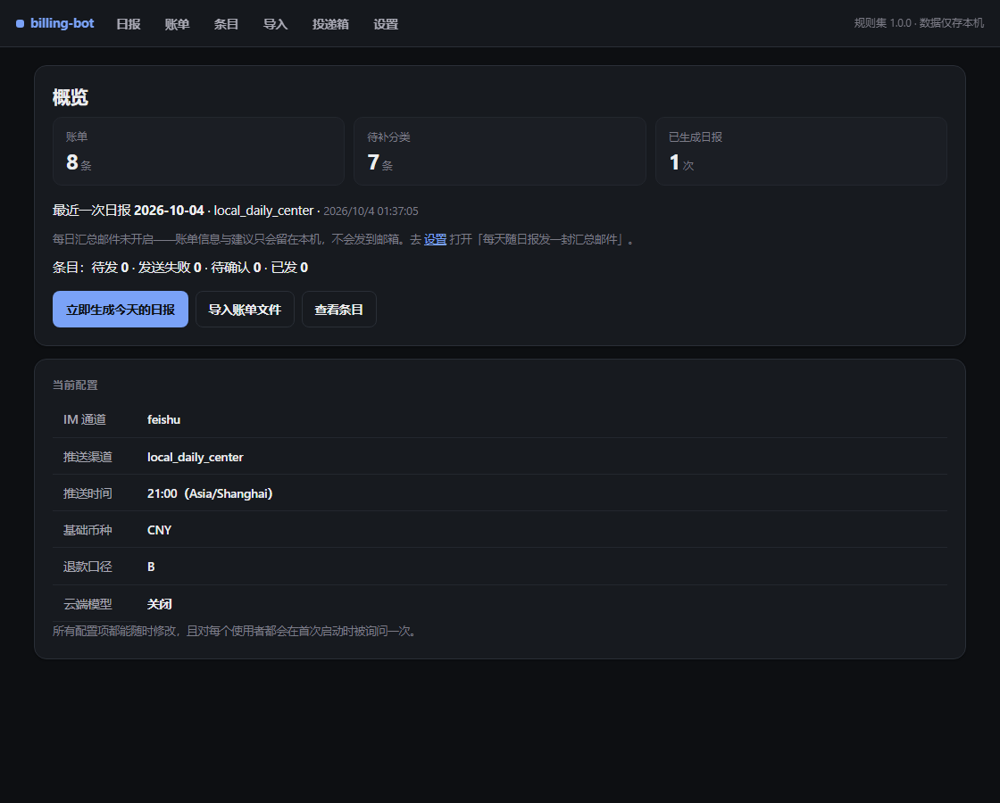
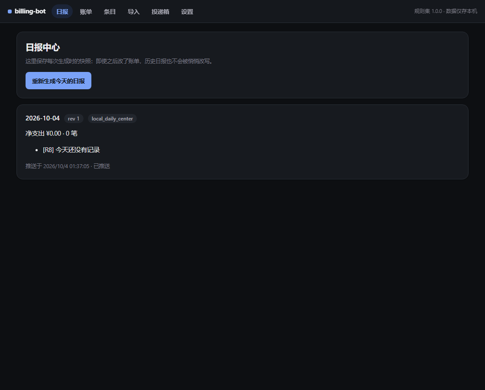
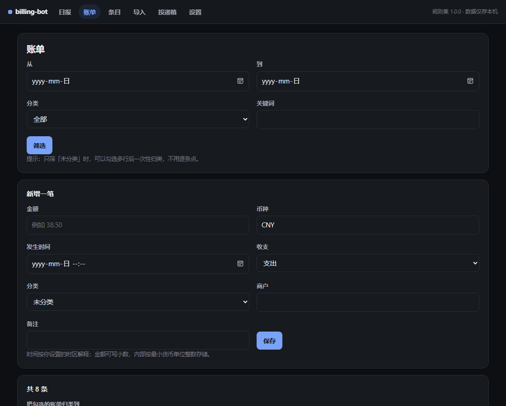
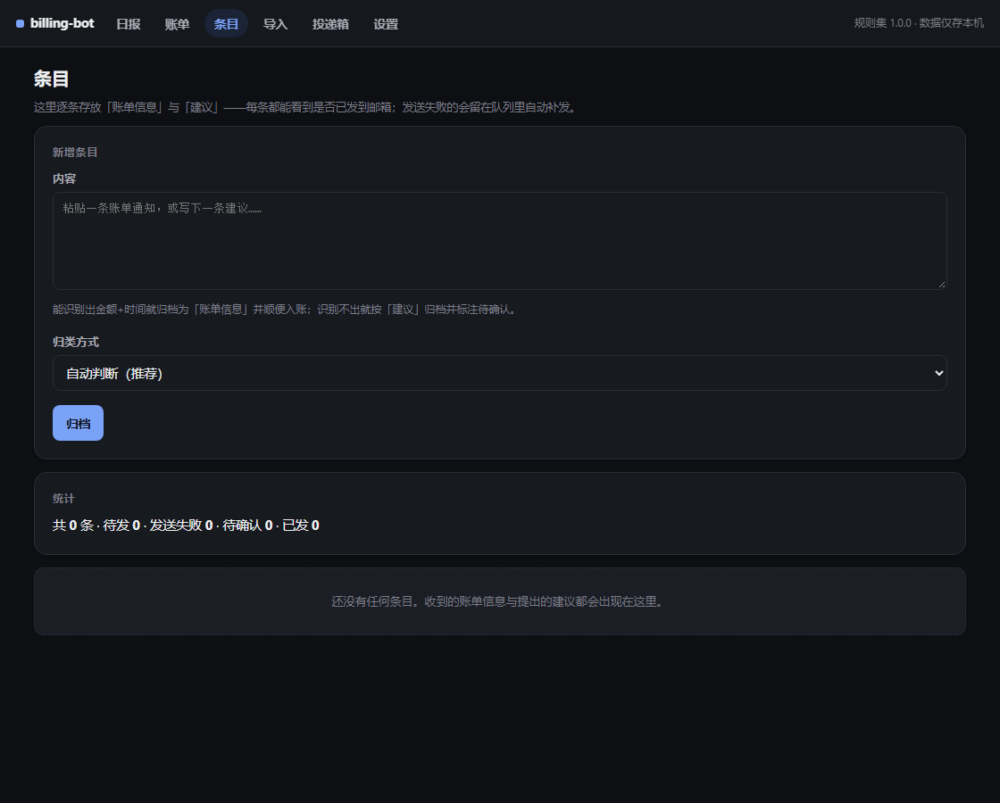
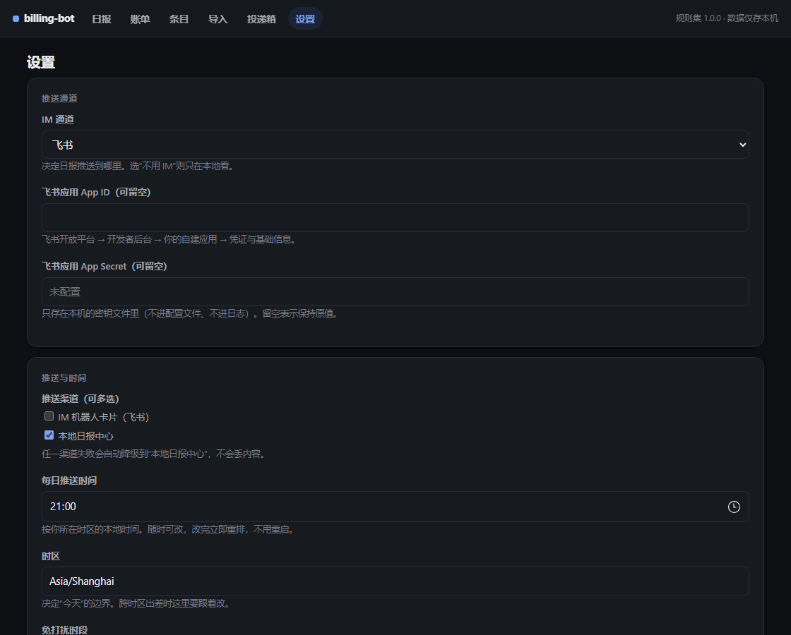

# billing-bot

本地账单管理 + 每日支出分析建议。**数据全部留在本机**，日报通过飞书机器人卡片送达。

形态 A：本机常驻 Node 服务 + 本机 SQLite + 本地网页界面 + 飞书卡片（设计方案见 [`../账单管理插件设计方案.md`](<../账单管理插件设计方案.md>)）。

---

## 当前进度

| 阶段 | 状态 |
|---|---|
| **P0 领域层** | ✅ 完成：金额/校验/时区口径/退款 A·B·C/多币种/基线/R1–R9 规则/节流/渲染/脱敏 |
| **P1 存储与引导** | ✅ 完成：配置 Schema（26 个配置项，向导由 Schema 驱动）、SQLite 仓储（9 张表）、密钥分离存放、首次引导向导 |
| **P2 账单导入** | ✅ 完成：CSV 状态机、编码自动识别（GBK/UTF-8/BOM）、支付宝/微信/银行列映射、三层幂等、导入报告、**投递箱（丢文件即导入）**、**消费通知邮件解析（.eml）**；⚠️ 待真实样例回归 |
| **P3 每日分析** | ✅ 完成：run_key 幂等、修正版、无数据日、降级、休眠补跑、调度器（免打扰顺延） |
| **P4 飞书通道** | ✅ 代码完成：token 缓存、卡片构造、回调解析、按钮动作 → 反馈；**待凭证实测** |
| **P5 汇率与模型** | ✅ 完成：公共汇率适配（含倒数换算与缓存降级）、LLM 脱敏网关（出网前二次校验 + 留痕） |
| **P6 界面与打包** | ✅ 完成：本地 HTTP 界面（概览/引导/账单/日报/导入/设置/规则）、CLI、Windows 计划任务脚本 |

**验证结果（本机实跑）**

```
node --test "tests/**/*.test.ts"   →  tests 178 | pass 178 | fail 0
pnpm exec tsc --noEmit             →  exit 0
node src/main.ts --run-daily       →  正常生成并退出（exit 0）
node src/main.ts --port 8791       →  首页 200、引导页列出全部配置项、无令牌访问 403
```

---

## 运行

需要 **Node ≥ 22.18**（本项目用 Node 24 的原生 TypeScript 类型擦除直接跑 `.ts`，没有构建步骤）。

```bash
# 常驻服务：本地界面 + 每分钟调度检查
node src/main.ts
# 启动日志里会打印带令牌的地址，例如：
#   [billing-bot] 本地界面：http://127.0.0.1:8791/?token=xxxx

# 只跑一次今天的分析（**尊重幂等**：当天已推送就跳过；加 --force 才强制重推）
node src/main.ts --run-daily --no-server --no-scheduler
node src/main.ts --run-daily --no-server --no-scheduler --force
# 补跑最近 2 天
node src/main.ts --catchup 2 --no-server --no-scheduler
# 只要本地界面 / 只要调度器
node src/main.ts --no-scheduler
node src/main.ts --no-server
# 排查推送问题：打印每个渠道的真实结果
node scripts/push-now.ts

# 测试与类型检查
node --test "tests/**/*.test.ts"
pnpm exec tsc --noEmit
```

**开机自启（Windows，二选一，别同时开）**

```powershell
# 方式一：计划任务，每天定时跑一次（省内存，推荐；已实测 LastTaskResult=0）
powershell -NoProfile -ExecutionPolicy Bypass -File scripts/install-autostart.ps1 -Action install -Time 21:00
powershell -NoProfile -ExecutionPolicy Bypass -File scripts/install-autostart.ps1 -Action status
powershell -NoProfile -ExecutionPolicy Bypass -File scripts/install-autostart.ps1 -Action remove

# 方式二：常驻服务（有本地界面，休眠靠启动补跑救回）
node src/main.ts
```

> ⚠️ **Windows 默认禁止运行 .ps1 脚本**（报 `UnauthorizedAccess`）。用上面的 `-ExecutionPolicy Bypass` 调用即可；或者照脚本里的三条命令直接在 PowerShell 里手动注册（内容与脚本一致）。
> ⚠️ 两种方式都尊重 `run_key` 幂等，**同时开着也不会各推一条**；但仍建议二选一，避免 21:00 整点抢占同一条记录。

数据目录默认 `%LOCALAPPDATA%\billing-bot`（macOS/Linux 为 `~/.local/share/billing-bot`），可用环境变量 `BILLING_BOT_HOME` 覆盖。里面只有三个东西：`config.json`、`secrets.json`、`billing.db`。

---

## 界面

> 以下截图为**样例数据**渲染，不含任何真实账单。











| 路径 | 作用 |
|---|---|
| `/` | 概览：账单数、待补分类数、最近日报、下次执行时间 |
| `/onboarding` | **首次引导**：8 步问完所有配置项（每个下载者都会走一遍） |
| `/bills` | 账单列表、筛选、手动新增、软删除 |
| `/import` | 上传支付宝/微信/银行 CSV，返回导入报告 |
| `/inbox` | **投递箱**：显示目录路径、待处理文件，一键扫描导入 |
| `/daily` | 日报中心：历史快照（改了账单也不会篡改历史日报） |
| `/settings` | 设置：全部配置项可随时改，保存即生效 |
| `/rules` | 规则说明：R1–R9 的含义 |

安全：只监听 `127.0.0.1`，首次带 `?token=` 换取 HttpOnly Cookie，之后无令牌一律 403。

---

## 关键设计决策

### 1. 配置项全部由 Schema 驱动（"每个下载者都要被问一遍"）

`src/infra/config/schema.ts` 是唯一真相：26 个配置项写在 `CONFIG_FIELDS` 里，**首次引导向导、设置页、校验、默认值全部由它推导**。想加一个配置项就必须登记进 Schema，向导会自动询问——这条铁律是结构性成立的，测试里有一条断言专门守着它（`tests/config.test.ts`）。

密钥（飞书 App Secret）走独立文件 `secrets.json`，不进 `config.json`、不进日志。

### 2. 幂等：同一天不会重复轰炸

```
run_key = 本地日期 : 规则集版本 : 配置内容哈希
```
- 已推送且账单没变 → 直接跳过
- 推送后账单变了（补记、改金额）→ 重算并发**修正版**（revision+1），而不是再发一条
- 用户改了配置 → 配置哈希变化 → 允许当日重算一次
- 休眠/关机漏跑 → 启动补跑（默认只回补最近 1 天），靠同一套幂等键保证不重复

### 3. 退款口径 B（用户选择）的确定行为

```
当日净支出 = 当日支出 − 归属退款当日的冲减额
```
历史日报**永不被后续退款改写**；若某日冲减后为负，显示"今日净支出为负（退款冲减）"而不是 0；切换口径不追溯重算历史。

导入的退款找不到原单时用哨兵值 `unlinked` 标记，统计上与手工关联原单的退款完全一致。

### 4. 多币种：无汇率就绝不合并

缺少汇率时 `netConvertedTotalMinor = null`，日报只按币种分组展示并提示"有 N 笔缺少汇率未计入合计"；依赖单一总额的规则（R1/R6/R9）自动跳过，而不是给一个错的数。汇率取"按发生日"优先，缺当日则回退最近可用值并标注。

### 5. 隐私边界（代码级固化，有测试守着）

- **卡片默认不带商户名与备注**：规则文案不内嵌商户名，商户只放在 `evidence` 里给本地界面用；发往 IM 的文本必须经 `cardDisplayText()`，测试断言默认输出里不含商户名。
- **云端模型只收脱敏载荷**：分类名 + 币种 + 规则模板 id + 金额**档位**。出网前还有一道 `assertNoForbiddenContent()`，把当天的真实商户名当敏感值再扫一遍；**校验不通过时一个字节都不会发出**（测试断言调用次数为 0）。
- **两处出网**（汇率、模型）都可关闭；关闭即完全离线。每次模型调用的脱敏载荷都在 `llm_call_log` 留痕，可查可清。

### 6. 数据不足时宁可不出建议

基线按"有账单的天"平均（空白日不当作 0，也不进样本）；样本不足进入冷启动，只出绝对阈值类规则；固定支出（房租等）计入总额但被异常检测剔除，避免每天都误报。

---

## 目录

```
src/
├─ domain/                     纯逻辑，零 IO，不 import 任何 infra/channels/server
│  ├─ types.ts money.ts bill.ts category.ts
│  ├─ analysis/  period(fx/baseline/budget/metrics/refund/stats)
│  ├─ rules/     ruleset.ts engine.ts
│  └─ advice/    throttle.ts render.ts redact.ts
├─ app/                        用例编排
│  ├─ onboarding.ts settings.ts budgetText.ts
│  ├─ runDailyAnalysis.ts  importBills.ts
├─ infra/
│  ├─ config/ schema.ts store.ts
│  ├─ db/     schema.ts database.ts + 8 个 repo
│  ├─ importer/ csv.ts mapping.ts
│  ├─ fx/publicProvider.ts   llm/gateway.ts
│  └─ scheduler/scheduler.ts
├─ channels/ adapter.ts localCenter.ts feishu/{client,card,callback,index}.ts
├─ server/   http.ts pages.ts
└─ main.ts
tests/                        178 项测试
scripts/install-autostart.ps1
samples/README.md             放脱敏账单样例的地方
```

依赖方向铁律：`domain/` 不认识宿主、数据库、通道；`infra/`、`channels/` 实现 `domain/` 定义的端口。

---

## 条目与每日汇总邮件（账单信息 / 建议 → 已绑定邮箱）

**这是一条长期规则**：凡是收到的账单信息、以及助手想提出的建议，都要
① 归到「条目」里逐条可查，② 随日报汇总发到已绑定邮箱。

### 两类内容怎么归档

| 收到的东西 | 归到哪 | 行为 |
|---|---|---|
| 能解析出金额+时间的通知 | **账单信息** | 顺便真正入账（`bill` 表），条目关联该账单 |
| 解析不出金额的文本 | **建议** | 存档 + 标注「**待确认**」（判断不出归属时按约定当建议，绝不丢弃） |
| 明确指定的内容 | 按指定 | 指定为账单但解析失败 → 仍然存档 + 标待确认 |

两个入口走同一段逻辑：

```bash
# 命令行（助手归档时用）
node src/main.ts --add-item "【工商银行】您尾号1234的储蓄卡10月03日21:05支出(消费)46.50元，余额1234.56元。"
node src/main.ts --add-item "建议：外卖频次偏高，可以设个上限"
```

界面上是「**条目**」页（左侧导航第 3 项）：可手填、可逐条查看，每条都显示
`账单信息/建议` + `待发/已发/发送失败` + `待确认` 标记。

### 汇总邮件怎么发

- **时机与粒度**：**随日报汇总，一天一封**（不做逐条实时轰炸）。每次生成日报后，
  把「日报正文 + 当日新增账单明细 + 队列里的条目」合成一封邮件发出。
- **配置**（设置 → 邮件自动抓取）：`每天随日报发一封汇总邮件` + `汇总邮件收件人`
  （留空=发给自己）。发信服务器默认按 IMAP 主机推导（`imap.qq.com` → `smtp.qq.com`），
  465 直连 TLS、587 用 STARTTLS，**用的是同一个授权码**。
- **失败不丢内容**：发送失败时条目留在"待发队列"并记录原因，**下次日报自动补发**；
  正文里会写明这是补发，概览页出现显式告警。补发成功即转「已发」。
- **投递延迟**：QQ 等邮箱对自发自收有几十秒延迟，属正常。
- **内容口径**：邮件是发给你自己的私人通道，因此**含商户名与完整明细**；
  这与"卡片默认脱敏"不冲突——卡片是推送到 IM 的通道，邮件是给你自己看的账本副本。

> 实现说明：邮件**不是**卡片推送渠道（`tryChannelsInOrder` 是"首个成功即停"，
> 挂进去会导致飞书成功后邮件被跳过）。它是日报之后的**独立发送**；
> 同时把 `push.channels` 里两个"选了也不会发"的假选项（系统通知 / 邮件）移除了。

## 测试覆盖（250 项）

| 文件 | 覆盖 |
|---|---|
| `period` | 跨时区归属、跨零点、DST 23h/25h、闰日、墙上时间→ISO |
| `money` `bill` | 整数分、币种小数位、硬/软校验、未来日期容差 |
| `refund` `fx` `metrics` `baseline` `budget` | 口径 A/B/C、缺汇率不合并、固定支出剔除、冷启动、预算进度 |
| `rules` `advice` | R1–R9 边界、节流、渲染、**隐私断言**、脱敏载荷与出网闸门 |
| `config` | Schema 覆盖所有配置项（铁律）、校验、迁移深合并、密钥分离 |
| `db` | 迁移、幂等插入、乐观锁、按日查询、多表仓储、事务回滚 |
| `import` | CSV 状态机、GBK/BOM 识别、表头探测、支付宝/微信/银行、三层幂等 |
| `channels` | token 缓存、卡片结构、回调解析与动作映射、缺凭证降级 |
| `providers` | 汇率倒数换算、失败不清缓存、模型失败回退、留痕 |
| `daily` | 端到端：无数据日、推送、幂等跳过、修正版、配置变更、降级、补跑 |
| `inbox` | 投递即导入、同文件指纹拦截、跨文件单号去重、zip 明确跳过、失败归档、预览模式、上限控制、目录自动创建 |
| `notification` | 通知解析（金额/时间/商户/卡尾号）、**营销邮件误报拦截**、余额额度剔除、退款方向、跨年修正、自定义模板优先级、`.eml`（base64/QP/RFC2047/HTML 降级/附件）、Message-ID 幂等、丢进投递箱的端到端路径 |
| `mail` | IMAP 前置条件校验、连接失败与依赖缺失的降级、通知入账/营销跳过、重复抓取不重复记账、预览模式**完全不写库**、回溯天数与 SSL 端口推导、单封失败不影响其它、邮件配置项被引导覆盖 |
| `scheduler` | 免打扰顺延（含跨零点）、到点执行、每日一次、漏跑补跑、并发保护 |
| `server` | 令牌校验、引导落盘、配置非法不写盘、账单增删、日报、导入、密钥不进配置文件 |

---

## 每天自动导入账单（投递箱）

**先说清楚什么做不到**：支付宝与微信的账单**无法做成完全无人值守的自动导入**，这不是技术问题，而是平台的有意设计——

1. 个人拿不到它们的开放接口（只对企业开放）；
2. 导出文件的**解压密码不在邮件里**，而是推送到支付宝消息 / 微信服务通知里，每次申请生成；
3. 任何声称"输账号密码就自动同步"的工具都走协议逆向，违反平台协议且有封号风险。

所以现实的做法是**把人工参与压缩成"把附件拖进一个文件夹"**：

```
数据目录/inbox/          ← 你把导出的 CSV 丢这里（或直接拖进去）
   ├─ done/             ← 处理成功的文件按时间戳归档，可回溯
   ├─ failed/           ← 处理失败的原文件保留，方便重试
   └─ inbox.log         ← 每次扫描的结果（JSONL）
```

**导入是自动发生的**：每次生成日报前都会先扫一遍投递箱。所以只要文件在目录里，日报生成时就已经算进去了。也可以手动触发：

```bash
node src/main.ts --import-inbox --no-server --no-scheduler   # 只扫一次然后退出
```

或者在界面的 **投递箱** 页面点「立即扫描并导入」。

**自动化的边界（诚实版）**：

| 环节 | 是否自动 |
|---|---|
| 从 App 导出账单（需要身份验证） | ❌ 必须人工 |
| 从邮箱下载附件 + 解压（密码在另一个 App 里） | ❌ 必须人工 |
| **把 CSV 放进目录之后的一切**（识别来源、编码、表头、去重、入库、归类、归档） | ✅ **全自动** |
| 忘记导时的提醒 | ✅ 日报里会提一句 |

四层去重保证你可以放心反复丢文件：文件指纹（同文件）、交易单号（同交易）、启发式疑似重复（同金额同商户同日）、以及日报本身的 `run_key` 幂等。

## 消费通知邮件解析（唯一"无人值守"的来源）

银行与信用卡的**每笔消费通知是主动推送的**——不需要导出、不需要解压密码、不需要人工参与。所以这是唯一能真正做到自动记账的数据源。

把通知邮件**另存为 `.eml` 丢进投递箱**即可自动记账，零依赖：

```bash
node src/main.ts --import-inbox --no-server --no-scheduler
# [inbox] 发现 2 个文件：导入 1，已导过 0，跳过 1，失败 0
#   · notice-cmb.eml：imported — 识别为消费通知：268.00 元 · 某川菜馆 · 支出（置信度 0.95）
#   · promo.eml：skipped — 未识别：看起来是营销/优惠类邮件（命中「立减」且没有账户尾号或交易金额标识）
```

**准确性设计（宁可不出，不可出错）**：

| 闸门 | 作用 |
|---|---|
| 交易关键词必需 | 正文没有"消费/支出/扣款/入账"这类词 → 直接不算通知 |
| 金额必需 | 抽不到可信金额 → 不识别、说明原因、文件留在原地 |
| **营销闸门** | "消费满 300 元立减 50 元"这类文案会被判为营销邮件（实测踩到的误报） |
| **噪声剔除** | 含"余额/可用额度/积分/账单日/分期"的句子整句剔除，再抽金额 |
| 方向判断 | 命中"退款/入账/转入" → 记为收入而非支出 |
| 时间兜底 | 通知没写时间才用邮件时间，并在备注标注"时间取自邮件" |
| 跨年修正 | 1 月收到"12月31日"的通知 → 自动回退到上一年 |
| 幂等 | 以邮件 `Message-ID` 为键，没有则用内容哈希；同一封邮件不会重复记账 |

邮件来源的账单标记为 `source='api'`、`tags=['邮件通知']`，界面上可筛选，也能与 CSV 导入的记录区分开。

**两个诚实的限制**：

1. 手动丢 `.eml`/`.txt` 仍需你动手一次——要彻底不用动手，见下面的 **IMAP 直连**。
2. 邮件里有商户名，所以**卡片里不会出现商户名**（沿用隐私规则），商户只进本地数据库。

**为你的银行定制模板**：内置通用模板覆盖常见写法；格式特殊时可加一条自定义模板（`matchAll` 定位 + 可选的 `occurredAt/merchant/cardTail` 正则），自定义模板优先于通用模板，命中排除词则直接跳过。

### IMAP 直连：彻底不用动手

在设置页填好邮箱，之后**每次生成日报前会自动连邮箱抓取并记账**：

| 配置项 | 说明 |
|---|---|
| `mail.enabled` | 总开关（默认关） |
| `mail.imapHost` | QQ `imap.qq.com`｜163 `imap.163.com`｜Gmail `imap.gmail.com`｜Outlook `outlook.office365.com`｜iCloud `imap.mail.me.com` |
| `mail.imapPort` | 默认 993（SSL）；143 会自动用非 SSL |
| `mail.user` | 完整邮箱地址 |
| `mail.password` | **IMAP 授权码，不是登录密码**（QQ/163 必须用授权码；Gmail 用应用专用密码）→ 只存本机密钥文件 |
| `mail.mailbox` | 默认 `INBOX`；若你把通知归到了某个文件夹就填那个 |
| `mail.lookbackDays` | 每次回看最近几天（默认 7），重复的不会重复记账，放宽更保险 |

```bash
node src/main.ts --fetch-mail --no-server --no-scheduler          # 手动抓一次
node src/main.ts --fetch-mail --dry-run --no-server --no-scheduler # 只看能识别出什么，不写库
```

**不碰你的邮箱**：不标已读、不移动、不删除。去重靠邮件 `Message-ID`，所以反复扫描同一批邮件不会产生重复账单。

**关于依赖**：IMAP 需要 `imapflow`，它是**唯一一个可选依赖**（`optionalDependencies`）。没装时邮件抓取会报一句可读的错误、其余功能完全不受影响；手写 IMAP 要处理 163 的 `ID` 命令、UTF-7 邮箱名、字面量分帧等一堆怪癖，风险远大于收益。

## 飞书接入清单（2026-10-03 实测）

用真实的 `cli_` 应用验证过一次，结论如下，照着做即可：

| 步骤 | 说明 | 结果 |
|---|---|---|
| 1. 凭证 | 开发者后台 → 凭证与基础信息，拿 App ID / App Secret | ✅ **已验证有效**（成功换到 `tenant_access_token`） |
| 2. 写入本机 | `BB_APP_ID=cli_xxx BB_APP_SECRET=xxx node scripts/configure-feishu.ts` | ✅ App ID 进 `config.json`，Secret 进 `secrets.json`（0600） |
| 3. 权限 | `im:message:send_as_bot`（发消息）+ `im:chat:readonly`（自动发现接收人） | ✅ 均已生效 |
| 4. 发布版本 | **权限变更后必须在「版本管理与发布」创建新版本并发布**，否则权限不生效 | ✅ 已发布 |
| 5. 接收人 | `oc_…`=群、含 `@`=邮箱、`ou_…`=open_id，三种都能发 | ✅ `chat_id=oc_a6ffde15…`（机器人已在群内） |
| 6. 真实送达 | `node scripts/push-now.ts` | ✅ **已送达**：`im_card：已发送（chat_id=… message_id=om_x100b633bcce4b4a0…）` |

**P4 已闭环**：`node src/main.ts --run-daily` 走的正式路径会把日报投递到飞书群，失败才降级到本地日报中心。

**接收人获取的实测要点**：

- 脚本会自动打印机器人名字（`bot/v3/info`），照着名字在飞书里搜索添加即可。
- `im/v1/chats` **只列机器人在的「群」**——与机器人的**单聊（p2p）不在列表里**。所以"打开与机器人的会话"没用，必须**新建一个群并把机器人拉进去**。
- `--to` 支持直接粘**群链接**（`openChatId=oc_…`），脚本会自动提取 ID。

**判权限的技巧（已实证）**：往一个不存在的 open_id 发消息——

- 返回 `99991672 Access denied … scopes required` → 是**权限**没开
- 返回 `99992351 not a valid {open_id} or not exists` → 权限**已开**，纯粹是 ID 不对

两种情况的 HTTP 状态码都是 200，**必须看业务码**。这个探针能在不知道真实 ID 的情况下判定发送权限。举例：

```bash
node scripts/feishu-check.ts --send --to ou_aaaaaaaaaaaaaaaaaaaaaaaaaaaaaaaa
# → ✅ 接收人：open_id=...
# → ❌ 发送失败：code=99992351 ... not exists   ← 说明权限没问题，只差真实 ID
```


一键申请权限的链接（把 `{appId}` 换成你的）：

```
https://open.feishu.cn/app/{appId}/auth?q=im:message:send_as_bot,im:chat:readonly&op_from=openapi&token_type=tenant
```

诊断命令：

```bash
node scripts/feishu-check.ts                    # 验凭证 + 尝试自动发现接收人
node scripts/feishu-check.ts --send --to ou_xxx # 指定接收人并发一张测试卡片
```

> 顺带记两条实测踩过的坑：
>
> 1. **HTTP 200 也可能失败**。凭证有效但没权限时，开放平台返回的是 HTTP 200 + 业务码 `99991672`；判断成败必须看 `code`。另外 `232034`（应用在当前企业未生效）几乎总是"权限改完没发布新版本"。
> 2. **群 ID 当 open_id 发会报 `99992351`（"ID 无效"）**，而这个报错长得像权限问题，极易误判。现在 `inferReceiveIdType()` 会按 ID 形态（`oc_`/`ou_`/含 `@`）自动选投递类型，并有回归测试锁死——这个 bug 正是真实推送到飞书时才暴露出来的。


| 事项 | 缺什么 | 现状 |
|---|---|---|
| 导入解析器定稿 | 支付宝/微信/银行**脱敏样例**各 1 份（放 `samples/`） | 已实现通用列映射 + 模板保存，真实文件可能要微调列名候选 |
| 飞书推送实测 | 自建应用 App ID / App Secret + 接收人 ID | 代码与单测完成；长连接需在本地进程集成飞书 SDK 才能实测（见下） |
| LLM 供应商 | 选一个 OpenAI 兼容端点 | 适配器已抽象，`llm.provider` 选 `none` 时完全离线 |
| 银行 XLSX | 是否需要支持 `.xlsx` | 目前只解析 CSV；xlsx 需要额外依赖，未纳入 |
| 数据库静态加密 | 是否需要 | 目前依赖磁盘加密；`secrets.json` 单独文件保护 |
| 周期账单摊销 | 是否需要（默认关闭） | 已作为配置项预留，统计仍按扣款日一次性计入 |

**关于飞书长连接**：出站发送（token + 发卡片）已经完整实现并测试；**入站回调**需要飞书 SDK 的 WebSocket 长连接能力，属于一个可选依赖。当前设计把回调处理拆成了纯函数（`channels/feishu/callback.ts`），拿到凭证后有两种接法：① 引入 `@larksuiteoapi/node-sdk` 起长连接把事件喂给 `parseCallback`；② 先用单向推送 + 本地日报中心做交互，之后再补长连接。
